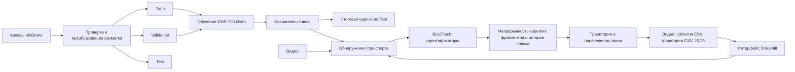

# Архитектура программы

## Компоненты

- `scripts/download_data.py`: получение опубликованных архивов с проверкой контрольных сумм.
- `scripts/prepare_visdrone.py`: проверка архивов и изображений, SHA-256, удаление точных дубликатов, преобразование рамок, манифесты и конфигурации.
- `scripts/run_experiment.py`: обучение, выбор лучшего checkpoint по validation, оценка и сохранение результатов.
- `traffic_cnn/counting.py`: конечный отрезок учета, зона нечувствительности, проверка смены стороны и однократный учет на ID.
- `traffic_cnn/tracklets.py`: однозначное сопоставление недавно потерянного фрагмента по прогнозируемой рамке и стабилизация класса по истории уверенности.
- `traffic_cnn/cli.py`: обработка видео, отслеживание, визуализация траекторий, экспорт и освобождение ресурсов.
- `app.py`: локальный пользовательский интерфейс. Модели предлагаются только после появления завершенного отчета эксперимента и в порядке оценки на validation.
- `scripts/evaluate_counting.py`: предварительное сравнение событий с визуальной разметкой демонстрационного видео.
- `scripts/make_report.py`: итоговая таблица и статический график сравнения.

## Границы ответственности

Сверточный детектор отвечает за обнаружение и классы. ByteTrack сопоставляет объекты по кадрам. Подсчет является отдельным правилом над траекториями; CNN не обучается напрямую предсказывать интенсивность потока.

Изображения VisDrone DET не содержат в этой конфигурации целевых меток скорости движения. Эксперимент обучения проверяет обнаружение объектов; точность отслеживания и подсчета нужно оценивать отдельно на видео.

Приложение хранит координаты в пикселях исходного кадра. FPS видео используется для времени событий. Требуется постоянная частота кадров; для записей с переменной частотой нужен иной учет временных меток.

Детектор сохраняет низкоуверенные рамки для восстановления существующих треков. Порог создания новых треков задается отдельно. `--baseline-tracking` используется для исследовательского сравнения на одинаковых весах. Сопоставление фрагментов отвергается при конкуренции или неоднозначности и не гарантирует физическую идентичность машины.

Экспортируются события, наблюдения, пиксельный путь, смещения и число видимых треков по кадрам. H.264 используется при доступности кодека; иначе применяется mp4v. Прогресс записывается атомарно. Готовые каталоги вывода не перезаписываются.

Интенсивность — число событий, деленное на длительность видео, с пересчетом в машин/час. Положение линии и опорная точка определяют, что считается событием. Идентификатор трекера не является постоянной идентичностью физического автомобиля.
