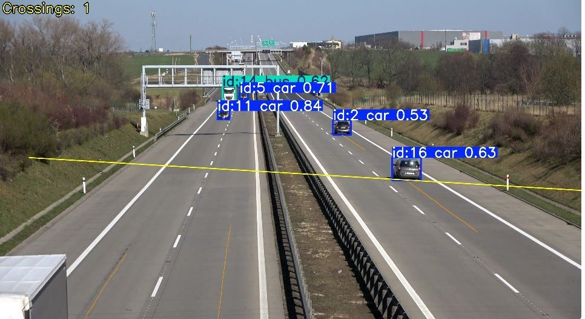

# Տեսախցիկներով երթևեկության հոսքի վերլուծության ծրագրային միջոց

[](https://github.com/marrr862/traffic-cnn/actions/workflows/tests.yml)

*Vehicle detection (YOLOv8), tracking (ByteTrack), line counting, speed (km/h), density and level of service from traffic camera video, with a Streamlit UI. Diploma project; documentation in Armenian, with a Russian version in [README.ru.md](README.ru.md).*



Դիպլոմային աշխատանք՝ «Տեսախցիկների միջոցով տրանսպորտային միջոցների շարժման և երթևեկության հոսքի վերլուծության ծրագրային միջոցի մշակումը» (Ղազարյան Մարիամ Սարգիսի)։

Python հավելվածը տեսանյութում հայտնաբերում է տրանսպորտային միջոցները CNN-ով (YOLOv8s / YOLOv8n, ուսուցանված VisDrone2019-DET և MIO-TCD ճանապարհային տեսախցիկների կորպուսներով), հետագծում է ByteTrack-ով և հաշվարկում է՝

- հատումները մեկ կամ մի քանի հաշվման գծով, ըստ ուղղությունների և դասերի;
- ինտենսիվությունը (մեքենա/ժամ) և վիճակագրությունը ժամանակային միջակայքերով;
- յուրաքանչյուր մեքենայի արագությունը կմ/ժ-ով (ճանապարհային հարթության հոմոգրաֆիկ տրամաչափում);
- գոտու խտությունը (մեքենա/կմ, մեքենա/կմ/գոտի) և սպասարկման մակարդակը (LOS A–F);
- հոսքի հիմնական հավասարման ստուգումը q = k·v;
- ջերմային քարտեզը և հետագծերի պատկերը։

## Մոդելներ

| Մոդել | VisDrone թեստ mAP50 (960) | MIO-TCD թեստ mAP50 (640) | UA-DETRAC AP50 / հաշվարկ | Մայրուղի (10 հատում) |
|---|---|---|---|---|
| vehicle-hires-960 (միայն VisDrone) | 45,9% | 15,1% | 96,7% / 5 / 5 | 9 / 10 |
| vehicle-road-combined (YOLOv8n, VisDrone + MIO-TCD, ավելի արագ) | 43,0% | 83,7% | 97,4% / 5 / 5 | 9 / 10 |
| **vehicle-road-yolov8s** (YOLOv8s, VisDrone + MIO-TCD, առաջարկվող) | **48,0%** | **86,8%** | 96,5% / 5 / 5 | 9 / 10 |

Առաջարկվող մոդելը նշված է `reports/recommended-model.json`-ում (ճանապարհային տեսախցիկներ, 960 պքս)։ Թույլ համակարգչի դեպքում ընտրեք ավելի արագ `vehicle-road-combined`-ը (մոտ 15%-ով արագ)։ Անօդաչու սարքի (վերևից) պատկերների համար ավելի հարմար է `vehicle-hires-960`-ը։

## Տեղադրում

Python 3.10–3.13։

```sh
git clone https://github.com/marrr862/traffic-cnn.git
cd traffic-cnn
python3 -m venv .venv
source .venv/bin/activate
python -m pip install -e '.[dev]'
python scripts/download_assets.py
```

`download_assets.py`-ը ներբեռնում է երեք ուսուցանված մոդելները (GitHub Release v1.0) `runs/experiments/<մոդել>/weights/best.pt` և երկու ցուցադրական տեսանյութերը (Roboflow Supervision) `data/video/` պանակ՝ ստուգելով SHA-256-ը։

## Արագ մեկնարկ

```sh
source .venv/bin/activate
python -m streamlit run app.py --server.address 127.0.0.1 --server.port 8501
```

կամ macOS-ում՝ `run_app.command`։ Դիտարկիչում բացեք http://127.0.0.1:8501։

## Հրամանային տող

```sh
traffic-cnn analyze --video data/video/vehicles.mp4 \
  --weights runs/experiments/<մոդել>/weights/best.pt --output outputs/my-run \
  --line 0 1296 3839 1296 --extra-line 0 1700 3839 1700 \
  --calibration configs/calibration-vehicles.json --imgsz 960 --device mps
```

Տրամաչափման ֆայլը (JSON) պարունակում է ճանապարհի ուղղանկյան չորս անկյունները կադրում (հեռավոր ձախ, հեռավոր աջ, մոտ աջ, մոտ ձախ), դրա լայնությունը և երկարությունը մետրերով և գոտիների քանակը։ Օրինակներ՝ `configs/calibration-*.json`։

## Սալիկային հայտնաբերում (անօդաչու սարքի տեսանյութեր)

Վերևից նկարահանված կամ 4K կադրերում մեքենաները շատ փոքր են։ `--tile 640` (կամ հավելվածում «Սալիկային հայտնաբերում») ռեժիմում կադրը բաժանվում է 20% համընկնող մասերի, յուրաքանչյուրը մշակվում է CNN-ով, ավելացվում է ամբողջ կադրի անցումը, և արդյունքները միավորվում են NMS-ով (եզրերով կտրված մեքենաները հեռացվում են)։ Հետագծումը (ByteTrack) և հաշվարկը մնում են նույնը։

VisDrone թեստ (1610 պատկեր, միևնույն գնահատիչ, մեկ դաս յուրաքանչյուր շրջանակի համար, ինչպես հավելվածում)․

| Մոդել և ռեժիմ | mAP50 | mAP50–95 | մս/պատկեր (M4) |
|---|---|---|---|
| vehicle-road-yolov8s, ամբողջ կադր 960 | 44,5% | 28,1% | 26 |
| vehicle-road-yolov8s, սալիկներ 800 + կադր | 47,6% | 30,3% | 166 |
| vehicle-hires-960, ամբողջ կադր 960 | 43,1% | 26,8% | 21 |
| **vehicle-hires-960, սալիկներ 640 + կադր 1280** | **49,8%** | **31,2%** | 156 |

Կարգավորումներն ընտրվել են ստուգողական (val) ընտրանքով, թեստը գործարկվել է մեկ անգամ (`scripts/evaluate_tiled.py`, `reports/tiled-*.json`)։ Ultralytics-ի ստանդարտ գնահատիչը (multi-label NMS) տալիս է մոտ 3–4 կետով բարձր թվեր, ուստի համեմատվում են միայն նույն աղյուսակի տողերը։ Անօդաչու սարքի տեսանյութերի համար խորհուրդ է տրվում `vehicle-hires-960` + սալիկներ 640։

## Ուղիղ հոսք

Հավելվածում ընտրեք «Ուղիղ հոսք»՝ տեսախցիկի համար (0, 1 …), `rtsp://` IP տեսախցիկ, HLS/MJPEG հասցե կամ YouTube հղում (`pip install -e '.[live]'`)։ Գծերը և տրամաչափման կետերը տեղադրվում են կադրի վրա սեղմելով։ Հրամանային տողում՝ `--video rtsp://… --max-seconds 120`։

## Ելքային ֆայլեր

| Ֆայլ | Պարունակություն |
|---|---|
| annotated.mp4 | Նշագրված տեսանյութ (շրջանակներ, ID, հետագծեր, արագություններ, գծեր, գոտի) |
| crossings.csv / line_crossings.csv | Հատումներ (կադր, ժամանակ, ID, դաս, ուղղություն, արագություն) |
| tracks.csv / tracks_summary.csv | Դիտարկումներ (պիքսելային և մետրական կոորդինատներ) և հետագծերի ամփոփում |
| frame_stats.csv / flow_windows.csv | Վիճակագրություն ըստ կադրերի և միջակայքերի (խտություն, միջին արագություն) |
| heatmap.png / trajectories.png | Ջերմային քարտեզ, հետագծեր |
| summary.json | Բոլոր ցուցանիշները և մշակման պարամետրերը |

## Ուսուցում և ստուգում

```sh
python scripts/prepare_visdrone.py
python scripts/prepare_miotcd.py
python scripts/run_experiment.py --name my-run --data configs/visdrone-expanded-full.yaml --epochs 15 --imgsz 960 --device mps
python -m unittest discover -s tests -v
python scripts/evaluate_counting.py --results outputs/<արդյունք> --name check --reference reports/video-reference.json
python scripts/thesis_video_results.py --weights runs/experiments/<մոդել>/weights/best.pt --imgsz 960
```

Արդյունքները պահպանվում են `outputs/` և `reports/` պանակներում։ Ուսուցանված մոդելները ներբեռնվում են `scripts/download_assets.py`-ով։ Ստուգումները (`python -m unittest discover -s tests` կամ `pytest`) GitHub Actions-ում գործարկվում են յուրաքանչյուր push-ի ժամանակ. տեղական կշիռներ կամ արդյունքներ պահանջող ստուգումները բաց են թողնվում, եթե դրանք բացակայում են։

## Սահմանափակումներ

Արագությունն ու խտությունը ճիշտ են այնքանով, որքանով ճիշտ է տրամաչափումը (հարթ ճանապարհ, անշարժ տեսախցիկ)։ Արագացված (time-lapse) տեսանյութերի դեպքում արագությունը և ինտենսիվությունը ֆիզիկապես վավեր չեն. ծրագիրը զգուշացնում է, եթե մեդիան արագությունը > 160 կմ/ժ։ ID-ի փոխարկումները կարող են առաջացնել կրկնակի հաշվարկ։ MIO-TCD տվյալները տարածվում են CC BY-NC-SA 4.0 լիցենզիայով (ոչ առևտրային օգտագործում)։ Թիրախային տեսախցիկի պատկերներով լրացուցիչ ուսուցումը կբարձրացնի ճշտությունը։
